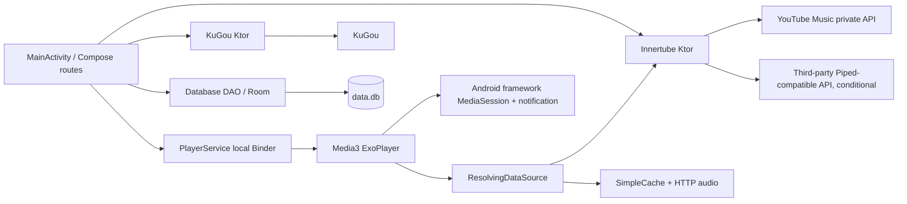

# Architecture

## Repository map

| Directory | Responsibility |
|---|---|
| [`app/`](../app) | Android app: `src/main/kotlin/it/vfsfitvnm/vimusic` application/activity, `ui/` Compose screens, `service/` playback, `models/` Room models, `utils/`, `enums/`; `res/` XML vectors, themes, fonts and icons; `schemas/` Room v1–23 exports; Gradle/proguard config. |
| [`innertube/`](../innertube) | Kotlin/JVM Ktor client, serialized request/response models and renderer-to-item adapters for unofficial YouTube Music endpoints. |
| [`kugou/`](../kugou) | Kotlin/JVM KuGou search, LRC fetch/normalize/parse. |
| [`ktor-client-brotli/`](../ktor-client-brotli) | Ktor Brotli response decompression plugin. |
| [`compose-routing/`](../compose-routing) | Custom route handlers and transitions. |
| [`compose-persist/`](../compose-persist) | Compose state map retained across activity configuration recreation, not durable storage. |
| [`compose-reordering/`](../compose-reordering) | Drag/reorder lazy-list UI. |
| [`gradle/`](../gradle) | Wrapper; root Gradle scripts configure plugins, repositories and version catalogs. |
| [`.github/`](../.github) | CI workflow and issue templates. |
| [`fastlane/`](../fastlane) | Store listing, screenshots and historical release notes; not application runtime. |

The seven modules are `:app`, `:innertube`, `:kugou`, `:ktor-client-brotli` and the three Compose libraries. The app directly uses the latter five except Brotli, which is used via `innertube`. The source is Kotlin, XML resources/manifest and Gradle Kotlin DSL; Room generates Java/Kotlin-related code via kapt. There is no application Java source architecture to map.

## Component contracts

| Subsystem / entry | Called by; input → output | Dependencies and downstream calls | Location |
|---|---|---|---|
| Process startup | Android creates `MainApplication` → initializes database and supplies Coil `ImageLoader` | Room, preferences, disk cache | [`MainApplication.kt`](../app/src/main/kotlin/it/vfsfitvnm/vimusic/MainApplication.kt) |
| UI lifecycle | Android creates `MainActivity`, `onStart` binds playback; `onStop` unbinds; launcher/deep links → Compose routes | binder, preferences, custom route/persist, DB and HTTP clients | [`MainActivity.kt`](../app/src/main/kotlin/it/vfsfitvnm/vimusic/MainActivity.kt), `ui/screens/Routes.kt` |
| UI state/navigation | screen composables receive route parameters/user events → UI and player commands | `remember`, `rememberSaveable`, flows and `persist`, `RouteHandler`; direct DAO/client calls | `app/.../ui/screens/`, `compose-routing/`, `compose-persist/` |
| Playback | bound/started `PlayerService` receives MediaItems and controls → player state/audio/notification | ExoPlayer, resolver/cache, Innertube, DAO, Android MediaSession | [`PlayerService.kt`](../app/src/main/kotlin/it/vfsfitvnm/vimusic/service/PlayerService.kt) |
| Remote metadata | screen/service calls `Innertube` with typed body → nullable `Result` of item/page/player models | Ktor OkHttp, renderer conversion, external APIs | `innertube/.../requests/`, `models/` |
| Synchronized lyrics | lyrics composable calls `KuGou.lyrics(artist,title,duration)` → nullable `Result<Lyrics?>` | Ktor, song/hash/lyrics endpoints | `kugou/.../KuGou.kt` |
| Persistence | UI and service call singleton `Database` DAO, passing IDs/entities → Flow or query result | Room `DatabaseInitializer`, SQLite executors | [`Database.kt`](../app/src/main/kotlin/it/vfsfitvnm/vimusic/Database.kt), `models/` |
| Car browser | when enabled, Android binds `PlayerMediaBrowserService` → media catalog/session callbacks | binds PlayerService and reads Room/cache | [`PlayerMediaBrowserService.kt`](../app/src/main/kotlin/it/vfsfitvnm/vimusic/service/PlayerMediaBrowserService.kt) |

There is no DI framework, repository/use-case layer, or ViewModel architecture in this checkout: wiring is manual using objects, a DAO companion delegating to the initialized Room instance, `CompositionLocal` and local service binder. Business logic is distributed among Compose screens, extensions, clients, DAO and service. Coroutines, Room executors and callbacks handle async work; no WorkManager usage was found. This coupling complicates isolated tests. See [flow](APP_FLOW.md) and [database](DATABASE.md).
