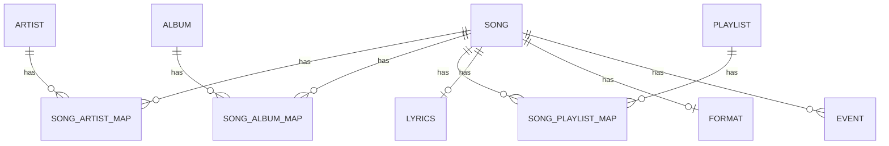
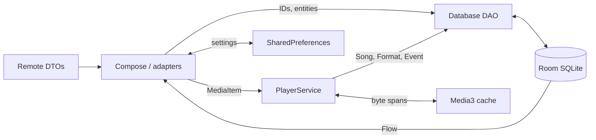

# Database and data flow

[`Database.kt`](../app/src/main/kotlin/it/vfsfitvnm/vimusic/Database.kt) defines a single `@Dao interface Database`; its companion delegates to `DatabaseInitializer.Instance.database`. `MainApplication` creates Room `data.db`, schema **23**, exports enabled. Queries return `Flow` for observable lists/entities or synchronous values; `query {}` and `transaction {}` use Room executors. There is no separate repository abstraction. `app/schemas/it.vfsfitvnm.vimusic.DatabaseInitializer/1.json` through `23.json` are checked in.

## Entities

All entity definitions are under [`app/src/main/kotlin/it/vfsfitvnm/vimusic/models/`](../app/src/main/kotlin/it/vfsfitvnm/vimusic/models):

| Table (key) | Purpose / significant fields |
|---|---|
| `Song` (string video ID) | title, artists text, duration text, thumbnail, likedAt, totalPlayTimeMs. |
| `Artist` (string ID) | name, thumbnail, timestamp and bookmarkedAt. |
| `Album` (string ID) | title, thumbnail, year, authorsText, shareUrl, timestamp, bookmarkedAt. |
| `Playlist` (autogenerated long) | name, optional remote browseId. |
| `SongArtistMap` (songId, artistId) | song–artist junction. |
| `SongAlbumMap` (songId, albumId) | song–album junction and nullable position. |
| `SongPlaylistMap` (songId, playlistId) | song–local playlist junction and position; same song cannot appear twice in a playlist with this key. |
| `Lyrics` (songId) | nullable fixed and synced lyrics. |
| `Format` (songId) | itag, MIME, bitrate, length, lastModified, loudness; no stream URL stored here. |
| `Event` (autogenerated long) | songId, timestamp and playTime for listening history/quick picks. |
| `SearchQuery` (autogenerated long) | unique query for local history. |
| `QueuedMediaItem` (autogenerated long) | Media3 item in BLOB via Room converters and nullable current position. |

Map foreign keys cascade on song and target deletion; Lyrics, Format and Event cascade from Song. `SortedSongPlaylistMap` is a SQL view sorted by position, used by `PlaylistWithSongs` relation. `Info`, `PlaylistPreview`, `SongWithContentLength`, `PlaylistWithSongs` are projections/relations, not extra tables. Innertube renderer models are remote DTOs and are converted into app models/MediaItems; the local string IDs commonly correspond to YouTube IDs/browse IDs.

## Operations, migrations and synchronization

The DAO includes sorted song/favorite lists, local search, album/artist bookmarks, playlists and ordered maps, insert/update/delete/upsert, `format`/lyrics lookups and event statistics. `onPlaybackStatsReady` adds play time for >5 s and inserts events for >30 s. These numbers record local analytics, not network analytics; >30 s is not a playback-stop mechanism. Album/artist screens use timestamps for metadata refresh; remote results are not a transactional remote library mirror. Local playlists can be imported/synchronized from remote playlist content through user actions; there is no account-level bidirectional sync. In `LocalPlaylistSongs.kt`, sync clears and replaces the local list after `completed()`. `utils/Utils.kt` returns a successful partial result if a continuation fails, so this path can discard locally present entries; see [known issues](KNOWN_ISSUES.md). SharedPreferences are separate (`utils/Preferences.kt`); cache is separate Media3/Coil disk state.

Auto migrations: 1→2→3→4→5→6→7→8; 9→10; 11→12→13→14; 15→16→17→18→19→20→21→22, with explicit specs for 3→4, 7→8, 11→12, 20→21 and 21→22. Manual `From8To9Migration`, `From10To11Migration`, `From14To15Migration`, `From22To23Migration` are registered in the builder. Inspect SQL/specs in `Database.kt` before changes; exported schemas alone do not prove every upgrade works. No migration tests were found.

`DatabaseSettings.kt` checkpoints WAL and exports SQLite to a user-selected document; restore closes the DB and copies from a selected document before stopping/restarting the app. This is sensitive user data and imported DB validity/recovery deserve tests. See [security](SECURITY_AND_PRIVACY.md).

