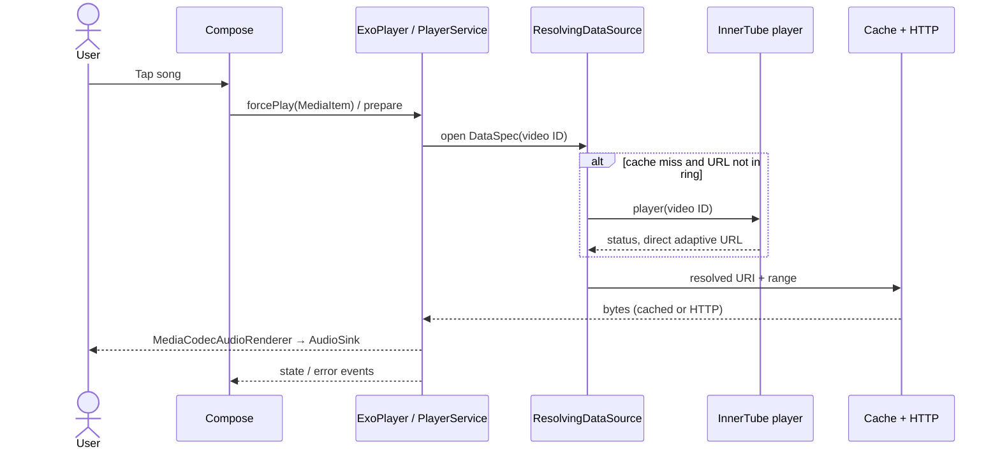

# Playback engine and failure investigation

## From tap to speakers

1. `ui/screens/searchresult/SearchResultScreen.kt` (among other screens) converts a `SongItem` using `utils/Utils.kt` `asMediaItem`. It sets `mediaId`, placeholder URI and `customCacheKey` to the video ID; title, artist, artwork and extras become Media3 metadata.
2. `utils/Player.kt` `forcePlay` sets the item, `playWhenReady=true` and `prepare()`. The activity's local `PlayerService.Binder` exposes the actual player. Search also invokes `setupRadio`.
3. `PlayerService.createMediaSourceFactory` wires `DefaultMediaSourceFactory` → `ResolvingDataSource` → `CacheDataSource` → `DefaultHttpDataSource`. The cache key is the video ID. A 512 KiB cache coverage check avoids resolution for a fully cached span.
4. On a miss, `createDataSourceFactory` checks a two-entry in-memory `(videoId, Uri)` ring. On a ring miss it synchronously calls `Innertube.player(PlayerBody(videoId))` from the loader via `runBlocking(Dispatchers.IO)`. A matching returned video ID and `OK` status are required. `highestQualityFormat` selects the *last* itag 251 or 140 in response order. It stores Song/Format metadata asynchronously; it does not use a separate repository or NewPipe.
5. The selected direct URL goes into the ring and `dataSpec.withUri(url).subrange(dataSpec.uriPositionOffset, 512 * 1024L)` on that initial resolution path. Ring hits use `withUri` without that explicit subrange. For a non-OK player result there is a conditional embedded-client/Piped path, detailed in [API integrations](API_INTEGRATIONS.md). Media3 upstream uses a fixed Firefox User-Agent and standard HTTP range behavior, not NewPipe-supplied headers.
6. Media3 reads and caches the network bytes and extracts Matroska or fragmented MP4 with explicitly provided extractors. Its `MediaCodecAudioRenderer` and `DefaultAudioSink` decode/output to the platform audio track and device. Buffering behavior is Media3 defaults; no custom load control is configured. Silence skipping and Sonic processors are configured, offload disabled; optional `LoudnessEnhancer` normalizes volume.
7. `Player.Listener` events update Compose state, framework `android.media.session.MediaSession`, metadata, artwork and notification; session callbacks and notification actions call the player. This is Media3 ExoPlayer plus the **framework** MediaSession, not a Media3 `MediaSessionService`. On player error, `Thumbnail.kt` maps a few `error.cause.cause` types, otherwise shows “An unknown playback error has occurred”; tapping dismiss invokes `prepare()`.

## Controls, lifecycle and persistence

* Player owns the queue; `forcePlayAtIndex`, `addNext`, `enqueue`, shuffle and reorder change its timeline. `YouTubeRadio.process()` uses `next` plus continuation; `maybeProcessRadio` adds more near the end. Session queue exposes up to 15 nearby items. Track transitions update radio, artwork and volume. Seek uses ExoPlayer `seekTo`; callbacks include previous/next and seeking.
* Audio focus is delegated to Media3 via `.setAudioAttributes(..., true)`. `.setHandleAudioBecomingNoisy(true)` covers output becoming noisy (e.g. disconnect); optional `AudioDeviceCallback` resumes on wired/Bluetooth connection. `WAKE_MODE_LOCAL` and foreground notification support background playback; device-specific behavior not tested.
* `SimpleCache` in `cacheDir/exoplayer` uses configured LRU (default 2 GB) or unlimited `NoOpCacheEvictor`. Audio is opportunistically cached, not a managed download. Offline list filters songs by stored content length and cache completeness. Cache may be evicted/cleared and partially cached content still needs network; no download service or durable offline guarantee.
* If the persistent queue preference is enabled, `onDestroy` schedules a Room save of timeline plus current position. `onCreate` restores saved items and prepares them, then deletes the saved rows. Abrupt process death may skip `onDestroy`, and the asynchronous save is not guaranteed to complete; no automatic reliable crash recovery is demonstrated. It does not prove playback will auto-resume.
* Default Media3 loading policy may retry internally; no explicit app-level HTTP retry or URL invalidation/refresh exists. Service `maybeRecoverPlaybackError` prepares on a track transition; error-overlay dismiss also prepares. This is not a continuous refresh strategy.

## Reported stop after approximately 30 seconds — unverified hypotheses

No device, playback logs, network capture or reproducible case was supplied. The symptom is user-reported, not confirmed and no root cause is established.

1. **Range/chunk boundary — strongest timing lead, not proof.** The first ring-miss resolution explicitly limits its `DataSpec` to 524,288 bytes. At 128,000 bit/s that is ~32.8 seconds of payload; different bitrate, buffering, headers and container overhead change wall time. The code's cache check, `uriPositionOffset`, `subrange` and first-path versus ring-hit behavior need an actual Media3 request/EOF trace. It is not established that Media3 cannot reopen or that the range limit causes the symptom.
2. **Stale or restricted URL.** Ring entries have no expiry, HTTP-error invalidation or refresh; signed URLs can expire or be rejected, but timing, response status and provider policy are unknown. An HTTP 403, truncated response, timeout or changed CDN behavior could propagate as a generic playback error.
3. **Provider/player drift.** Old hardcoded client/visitor, missing cipher/`n`/proof-token handling or null URLs can make formats inaccessible; these more often may prevent starting, so they do not alone explain a specific 30-second boundary. The Piped branch is conditional and bitrate-matched; no general fallback is present.
4. **A separate 30-second timer is not evidence of this failure.** `utils/InvincibleService.kt` uses a 30,000 ms interval for the optional service-liveness mechanism; it calls `shouldBeInvincible()` which in `PlayerService` is true when playback should not be playing. It is not a configured track cutoff. Device lifecycle interactions remain untested.
5. **Error visibility.** The UI inspects exactly two cause levels, so normal HTTP/Media3 errors and differently wrapped causes are displayed as unknown. `PlaybackError` remembers the message without a key, potentially retaining a stale message.

Recommended diagnostic before a fix: reproduce cold-cache with multiple songs and bitrates; record wall time and media position, sanitized `PlaybackException.errorCode`, complete cause chain, HTTP status/Content-Range and requested byte positions/lengths, ring hit/miss and cache span; compare 524,288-byte boundary, warm-cache, seek/reopen, Wi-Fi/mobile and expiry behavior. Redact URLs, visitor IDs and headers. Create an isolated fake HTTP range server reproducing partial, expired and interrupted responses, then add regression tests; choose a change only after evidence. Do not assume a specific provider failure or bypass restrictions.
