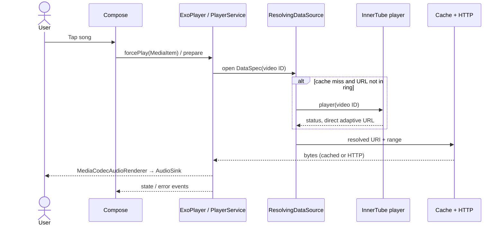

# Playback engine and failure investigation

## From tap to speakers

1. `ui/screens/searchresult/SearchResultScreen.kt` (among other screens) converts a `SongItem` using `utils/Utils.kt` `asMediaItem`. It sets `mediaId`, placeholder URI and `customCacheKey` to the video ID; title, artist, artwork and extras become Media3 metadata.
2. `utils/Player.kt` `forcePlay` sets the item, `playWhenReady=true` and `prepare()`. The activity's local `PlayerService.Binder` exposes the actual player. Search also invokes `setupRadio`.
3. `PlayerService.createMediaSourceFactory` wires `DefaultMediaSourceFactory` → `ResolvingDataSource` → `CacheDataSource` → `DefaultHttpDataSource`. The cache key is the video ID. A 512 KiB cache coverage check avoids resolution for a fully cached span.
4. On a miss, `createDataSourceFactory` checks a two-entry in-memory `(videoId, Uri)` ring. On a ring miss it synchronously calls `Innertube.player(PlayerBody(videoId))` from the loader via `runBlocking(Dispatchers.IO)`. A matching returned video ID and `OK` status are required. `highestQualityFormat` selects the *last* itag 251 or 140 in response order. It stores Song/Format metadata asynchronously; it does not use a separate repository or NewPipe.
5. The selected direct URL goes into the ring. `PlaybackDataSpecResolver` replaces only the URI, preserving position, URI offset, and length on both first resolution and ring hits. The 512 KiB constant remains only a cache coverage check, not a download limit. For a non-OK player result there is a conditional embedded-client/Piped path, detailed in [API integrations](API_INTEGRATIONS.md). Media3 upstream uses a fixed Firefox User-Agent and standard HTTP range behavior, not NewPipe-supplied headers.
6. Media3 reads and caches the network bytes and extracts Matroska or fragmented MP4 with explicitly provided extractors. Its `MediaCodecAudioRenderer` and `DefaultAudioSink` decode/output to the platform audio track and device. Buffering behavior is Media3 defaults; no custom load control is configured. Silence skipping and Sonic processors are configured, offload disabled; optional `LoudnessEnhancer` normalizes volume.
7. `Player.Listener` events update Compose state, framework `android.media.session.MediaSession`, metadata, artwork and notification; session callbacks and notification actions call the player. This is Media3 ExoPlayer plus the **framework** MediaSession, not a Media3 `MediaSessionService`. On player error, `PlaybackErrorDetails.kt` walks the cause chain and exposes exception class names, Media3 error code and HTTP status, without printing exception messages, signed URLs or bodies; tapping dismiss invokes `prepare()`. Debug builds also log sanitized errors and HTTP transfer metadata.

## Controls, lifecycle and persistence

* Player owns the queue; `forcePlayAtIndex`, `addNext`, `enqueue`, shuffle and reorder change its timeline. `YouTubeRadio.process()` uses `next` plus continuation; `maybeProcessRadio` adds more near the end. Session queue exposes up to 15 nearby items. Track transitions update radio, artwork and volume. Seek uses ExoPlayer `seekTo`; callbacks include previous/next and seeking.
* Audio focus is delegated to Media3 via `.setAudioAttributes(..., true)`. `.setHandleAudioBecomingNoisy(true)` covers output becoming noisy (e.g. disconnect); optional `AudioDeviceCallback` resumes on wired/Bluetooth connection. `WAKE_MODE_LOCAL` and foreground notification support background playback; device-specific behavior not tested.
* `SimpleCache` in `cacheDir/exoplayer` uses configured LRU (default 2 GB) or unlimited `NoOpCacheEvictor`. Audio is opportunistically cached, not a managed download. Offline list filters songs by stored content length and cache completeness. Cache may be evicted/cleared and partially cached content still needs network; no download service or durable offline guarantee.
* If the persistent queue preference is enabled, `onDestroy` schedules a Room save of timeline plus current position. `onCreate` restores saved items and prepares them, then deletes the saved rows. Abrupt process death may skip `onDestroy`, and the asynchronous save is not guaranteed to complete; no automatic reliable crash recovery is demonstrated. It does not prove playback will auto-resume.
* Media3 normally retries eligible I/O failures; the custom load policy keeps Ktor HTTP response failures non-retrying (as they were when wrapped as unexpected loader errors). No app-level URL invalidation/refresh exists. Service `maybeRecoverPlaybackError` prepares on a track transition; error-overlay dismiss also prepares. This is not a continuous refresh strategy.

## 512 KiB truncation: source-level root cause and remaining unknowns

Before this change, on a cache and URL-ring miss, `PlayerService.createDataSourceFactory` returned `dataSpec.withUri(url).subrange(dataSpec.uriPositionOffset, 512 * 1024L)`. It did so **outside** `CacheDataSource`, changing the extractor's requested range itself, and additionally applying `uriPositionOffset` as a relative offset. Ring hits did not apply the subrange. An open-ended request at offset 0 became a bounded 524,288-byte request. At 128,000 bit/s that is about 32.8 seconds of payload, but bitrate, container and buffering affect actual playback time.

The upstream [Media3 1.0.0-beta03 ResolvingDataSource](https://github.com/androidx/media/blob/1.0.0-beta03/libraries/datasource/src/main/java/androidx/media3/datasource/ResolvingDataSource.java) passes the resolved spec directly to its upstream. [CacheDataSource](https://github.com/androidx/media/blob/1.0.0-beta03/libraries/datasource/src/main/java/androidx/media3/datasource/cache/CacheDataSource.java) returns the bounded length from `open` and emits `RESULT_END_OF_INPUT` when its `bytesRemaining` becomes zero. It does not issue a subsequent range within that open once this artificial bound is consumed. [ProgressiveMediaPeriod](https://github.com/androidx/media/blob/1.0.0-beta03/libraries/exoplayer/src/main/java/androidx/media3/exoplayer/source/ProgressiveMediaPeriod.java) passes the apparent end position to the extractor. An extractor-initiated seek or retry may cause a *new* open; because the URL is then in the ring, that new open followed a different path. The exact resulting player state/error depends on the media and extractor.

The code defect is therefore in the **resolving data source's range transformation**, not evidence that the provider necessarily served only 512 KiB. The corrected resolver preserves the original DataSpec and URI offset, changing only the URL. The cache, HTTP upstream, extractor and player architecture remain intact. An isolated JVM experiment compiled the tagged upstream `DataSpec`, `ResolvingDataSource`, and `ByteArrayDataSource` with minimal Android stubs: against an 819,200-byte input the old transform returned/read 524,288 bytes in one open; the URI-only transform returned/read all 819,200 bytes in one open. This was a controlled library experiment, not an execution of the Android app, cache, network or extractor. This is a source-confirmed truncation defect; it is **not yet proven** to be the cause of the user's particular “Unknown error”. No device logs or original response headers were available, and no live provider traffic could be captured here. The API model supplies a URL but its implementation does not establish whether that URL points to a complete resource or a proxy; only provider traffic can answer that.

For HTTP, Media3 [HttpUtil](https://github.com/androidx/media/blob/1.0.0-beta03/libraries/datasource/src/main/java/androidx/media3/datasource/HttpUtil.java) generates `Range: bytes=start-end` for bounded specs and `bytes=start-` for nonzero open-ended specs; it omits Range for an open-ended position zero. `DefaultHttpDataSource` interprets Content-Length and Content-Range, skips bytes if a server responds 200 to a nonzero range, and exposes non-2xx (including most 416s) as `InvalidResponseCodeException`; it does not rely on Accept-Ranges to make the request. These are library-source findings, not observations of the live service.

For the reported Ktor 4xx cause chain, request phases, sanitized diagnostics, redirect/header findings, and missing incident evidence, see [the HTTP incident investigation](PLAYBACK_HTTP_INCIDENT.md).

## Diagnostics and verification

On a debug build, run `adb logcat -s PlaybackHttp:D PlaybackError:E`. Successful HTTP opens log requested position/length, status and validated Content-Length, Content-Range and Accept-Ranges. Failed HTTP status and the cause class chain appear in the player and `PlaybackError` log. Ktor response errors additionally include their request phase and allowlisted response fields. URI, media ID, arbitrary headers, arbitrary response text and exception messages are intentionally omitted; do not share signed URLs or credentials. Debug-only `src/debug` network policy explicitly allows cleartext for **127.0.0.1** for local tests; other hosts retain platform defaults and release policy is unchanged.

`app/src/androidTest/.../PlaybackRegressionTest.kt` adds resolver offset/length and cache-hit checks, privacy-safe error mapping, local HTTP 206 range/header checks, and a real Media3/CacheDataSource continuous-playback test using a synthetic 50-second AAC fixture. The latter requires playback past 37 seconds and checks the initial request is not capped. Six `connectedDebugAndroidTest` cases passed on an API 29 x86_64 emulator in [CI run 42466547585](https://github.com/Vicx01/ViMusic/actions/runs/42466547585), including real Media3 loader exception forwarding and retry-policy checks. Three substantive mocked Ktor resolver tests also passed. Local sandbox builds were blocked by the Gradle distribution host; the fixture was also independently decoded to 50.03 seconds with FFmpeg. The test uses a synthetic local server, not live providers.

Test on physical devices and test cold and warm cache against actual providers with multiple bitrates, seeks, background playback and network interruptions. Compare the resulting error type/status and response headers with this source analysis. URL expiration, throttling, provider restrictions, malformed responses, cache corruption and codec failures remain possible independent causes. No provider was replaced and no longer duration was hardcoded.
